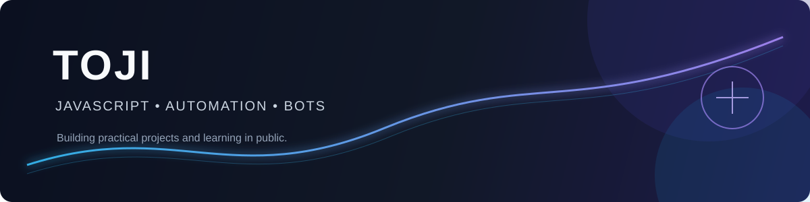

  

<h1 align="center">Toji</h1>

  Desenvolvedor independente focado em transformar ideias em projetos práticos com JavaScript, automação e bots.

  <a href="https://github.com/polarminhapomba-crypto?tab=repositories">Projetos</a> •
  <a href="https://github.com/polarminhapomba-crypto">GitHub</a>

## Sobre mim

Estou construindo minha trajetória na programação por meio de projetos reais. Gosto de criar automações úteis, testar ideias rapidamente e aprender colocando soluções para funcionar.

Neste momento, meu foco está em desenvolvimento com JavaScript, bots para comunidades online e deploy de aplicações leves na nuvem.

## Stack atual

  
  

## Projetos e aprendizado

Estou usando este perfil para documentar minha evolução na programação, testar ideias e publicar projetos práticos. Meu foco está em automação, bots e aplicações simples que possam ser colocadas em funcionamento com rapidez.

## O que estou construindo

- Projetos de automação que resolvem tarefas repetitivas.
- Bots e ferramentas para comunidades online.
- Aplicações simples, funcionais e fáceis de colocar em produção.
- Conhecimento prático em JavaScript, Node.js e infraestrutura básica.

## Estatísticas

  
  

## Objetivo

Continuar evoluindo como desenvolvedor, publicar projetos melhores e construir soluções que sejam úteis para outras pessoas.

  Construindo em público, um projeto de cada vez.

